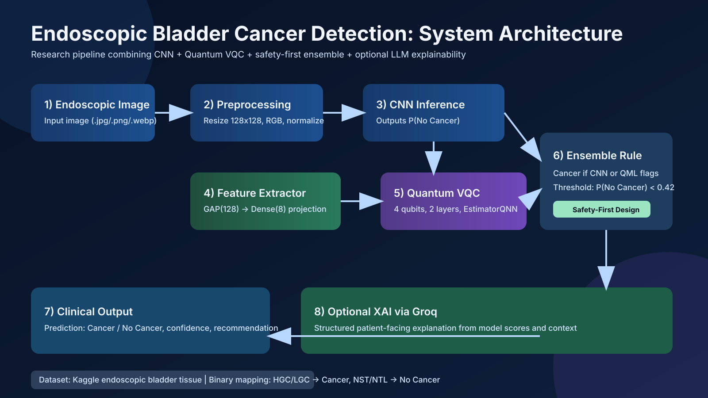
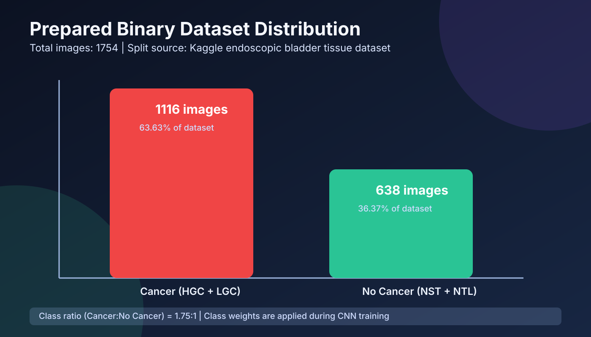
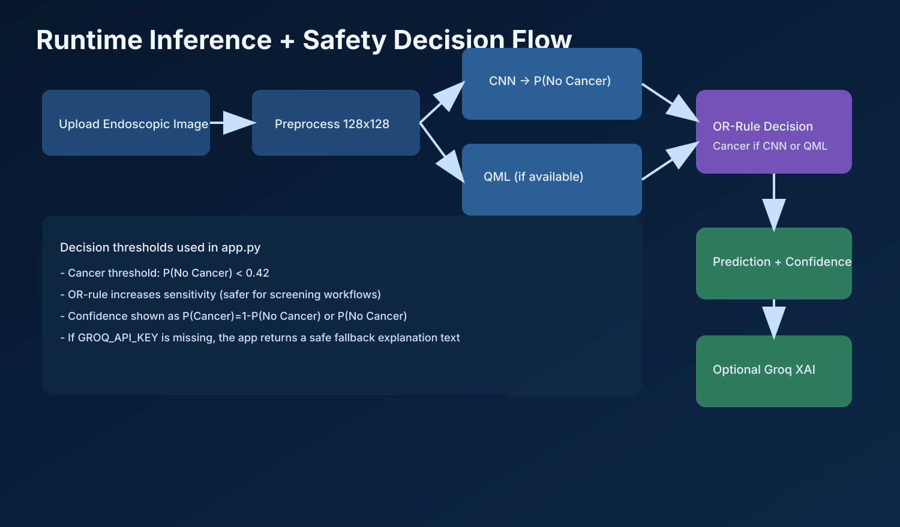
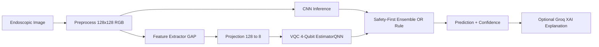

# Endoscopic Bladder Cancer Detection

Hybrid Quantum-Classical AI system for bladder endoscopy image classification with optional LLM-powered explainability.



This repository contains a full pipeline:
- Dataset acquisition from Kaggle
- Binary relabeling from 4 tissue classes to Cancer vs No Cancer
- Classical CNN training (TensorFlow/Keras)
- Hybrid quantum-classical refinement (Qiskit + PyTorch)
- Flask inference API + modern web UI
- Optional Groq XAI narrative generation

## Visual Overview

### 1) End-to-End System Architecture


### 2) Dataset Distribution (Prepared Binary Set)



### 3) Runtime Inference and Safety Decision Flow



## Clinical Scope

The model predicts whether an endoscopic bladder image is more likely to contain:
- Cancer tissue (HGC/LGC)
- No cancer tissue (NST/NTL)

This is a research/prototyping system and not a certified medical device.

## Project Architecture



See the rendered architecture diagram above for a publication-style visual summary.

## Repository Structure

- `app.py`: Flask backend, model loading, inference, ensemble logic, XAI integration.
- `index.html`: Frontend upload + results dashboard.
- `train_model.py`: Classical CNN training and binary dataset preparation.
- `train_qml.py`: Hybrid quantum-classical training on CNN features.
- `bladder_model.keras`: Trained CNN weights.
- `bladder_qml_model.pt`: Trained hybrid QML weights.
- `qml_meta.json`: QML metadata and best validation metrics.
- `class_mapping.json`: Multi-class to binary class mapping.
- `class_indices.json`: Runtime class index mapping.
- `data_binary/`: Prepared binary dataset (`Cancer/`, `No Cancer/`).

## Dataset

Source dataset used in the training script:
- Kaggle: `aryashah2k/endoscopic-bladder-tissue-classification-dataset`

Original tissue classes:
- HGC: High-Grade Carcinoma
- LGC: Low-Grade Carcinoma
- NST: Normal Squamous Tissue
- NTL: Normal Tissue Lining

Binary mapping used in this project:
- Cancer: HGC, LGC
- No Cancer: NST, NTL

Prepared dataset currently in repo:
- Cancer images: 1116
- No Cancer images: 638
- Total images: 1754

Class balance visualization is shown in the dataset chart above.

## Models and Training Details

### 1) Classical CNN (`train_model.py`)

Configuration:
- Input size: 128x128 RGB
- Batch size: 32
- Epochs: 30
- Validation split: 20%
- Loss: Binary crossentropy
- Optimizer: Adam (1e-3)
- Metrics: Accuracy, AUC, Precision, Recall
- Class balancing: weighted by class frequency

Augmentations:
- Rotation, shifts, shear, zoom
- Horizontal and vertical flip
- Brightness jitter

### 2) Hybrid Quantum-Classical Model (`train_qml.py`)

Pipeline:
- Freeze CNN backbone and extract 128-dim features
- Project features to 8 dims
- Reduce to 4 quantum inputs
- Variational Quantum Circuit with:
  - 4 qubits
  - 2 entangling layers
  - Ring CNOT topology
  - Parameterized RY rotations
- QNN: EstimatorQNN (Qiskit Machine Learning)
- Training loop in PyTorch with BCE loss

Saved QML metadata (`qml_meta.json`):
- `n_qubits`: 4
- `n_layers`: 2
- `classical_feat`: 8
- `vqc_trainable_params`: 8
- `best_val_acc`: 0.6171

## Inference Logic

`app.py` performs a safety-oriented ensemble:
- CNN outputs `P(No Cancer)`
- If QML is available, both models vote on cancer presence
- OR decision rule: if either model flags cancer, output `Cancer`
- This prioritizes sensitivity/recall for potential cancer detection

Thresholds:
- `CANCER_THRESH = 0.42`
- `NO_CANCER_THRESH = 0.58` (defined for confidence semantics)

## API Endpoints

- `GET /` -> Web UI
- `POST /predict` -> Multipart image inference
- `GET /health` -> Health/mode metadata

`POST /predict` request:
- Form field: `image`
- Supported formats: `.jpg`, `.jpeg`, `.png`, `.bmp`, `.webp`

Example response fields:
- `prediction`
- `confidence`
- `raw_score`
- `qml_raw`
- `model_mode`
- `xai_explanation`
- `status`, `title`, `message`, `urgency`, `recommendation`

## Quick Start

### 1) Create environment and install dependencies

```bash
python3 -m venv .venv
source .venv/bin/activate
pip install --upgrade pip
pip install -r requirements.txt
```

### 2) Configure optional XAI key

```bash
cp .env.example .env
# Edit .env and set GROQ_API_KEY
```

### 3) Run inference app

```bash
python app.py
```

Open:
- http://127.0.0.1:5050

## Reproducible Training

### Train classical model

```bash
python train_model.py
```

Outputs:
- `bladder_model.keras`
- `class_mapping.json`
- `class_indices.json`
- `data_binary/`

### Train hybrid QML model

```bash
python train_qml.py
```

Outputs:
- `bladder_qml_model.pt`
- `qml_meta.json`

## Security and Secrets

- API keys are not hardcoded.
- `GROQ_API_KEY` is read from environment variables.
- `.env` and environment variants are ignored by git.

If a key is not set, the app still works and returns a safe fallback XAI message.

## Performance Notes

- Current QML metadata reports `best_val_acc = 0.6171`.
- Clinical use requires substantially deeper evaluation:
  - Patient-level split strategy
  - External validation cohorts
  - Calibration analysis
  - Error analysis by class and acquisition conditions

## Limitations

- Dataset scale and class balance are limited.
- Image-level split may overestimate real-world generalization if not patient-stratified.
- Not approved for diagnosis or treatment decisions.

## Roadmap

- Add patient-level and center-level cross-validation
- Add Grad-CAM/attention visual overlays
- Add calibration curves and threshold tuning reports
- Add Docker + CI pipelines
- Add experiment tracking (MLflow/W&B)
- Add stronger model baselines and external test sets

## Citation and Attribution

If you use this repository academically, cite:
- The original Kaggle dataset author and source
- Qiskit and Qiskit Machine Learning
- TensorFlow and PyTorch

## Medical Disclaimer

This software is for research and educational purposes only.
It is not a medical device, and must not be used as a substitute for professional clinical judgment, diagnosis, or treatment.
